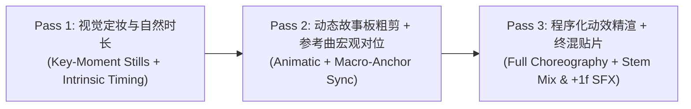

# 知识视频剧本、动态故事板（Animatic）、声画协同与程序化动效方法论 (v3.0)

> **定位**：交叉验证并融合国际头部视觉叙事工作室（Kurzgesagt、Vox、School of Motion）、GitHub 前沿程序化视频与动效工程（[`heygen-com/hyperframes`](https://github.com/heygen-com/hyperframes)、[`Orkas-AI/Orkas-VideoStudio`](https://github.com/Orkas-AI/Orkas-VideoStudio)、[`motion-canvas/motion-canvas`](https://github.com/motion-canvas/motion-canvas)、[`midrender/revideo`](https://github.com/midrender/revideo)、[`remotion-dev/remotion`](https://github.com/remotion-dev/remotion)、[`frankxai/awesome-motion-design-agent-skills`](https://github.com/frankxai/awesome-motion-design-agent-skills)、[`greensock/gsap-skills`](https://github.com/greensock/gsap-skills)、[`jkjkil4/JAnim`](https://github.com/jkjkil4/JAnim)）以及数据新闻视觉叙事（The Pudding / NYT Scrollytelling）。

---

## 一、 视觉与配乐（BGM）先后关系的工业级裁决：为什么严禁“先锁死等长音乐网格再画图”？

针对“先做视频再选 BGM、先敲定 BGM 卡点再做视频、还是视觉与配乐协同演进”的核心方法论问题，经交叉核验 **School of Motion（Boardomatic/Animatic 标准流）**、**Kurzgesagt（Epic Mountain 协同作曲流）**、**Orkas VideoStudio（`video-craft` §3）** 与 **HeyGen HyperFrames（`sound.md` & `film.md`）**，确立以下三阶协同铁律：

### 1. 两大常见误区诊断
- **误区 A（先锁死等长 BGM 节拍网格，再往里硬塞画面）**：
  - 在未绘制任何视觉关键帧（Styleframes / Key-Moment Stills）前，若将全片 20 个镜头强行锁死为等长的 `2 Bars = 6.40s`，会直接触发 **“节拍器催眠效应（Metronome Fatigue）”**。
  - 正如 `Orkas-AI/Orkas-VideoStudio` 的 `video-craft` §3 所指出：**“Shot/scene holds by format: explainer ~4–8 s. Don't hold the same length three times running — vary it.”（严禁连续三个镜头保持相同驻留时长）**。简单的双屏反差镜（如 `S02`）只需 `4.6s–5.2s`，硬撑到 `6.4s` 会产生 1.5 秒死气沉沉的画面空转（Dead Air）；而高密度机制图表镜（如 `S13` 杜克 1652 人劈叉曲线、`S16` 三重同心环总装）则需要 `6.8s–7.6s` 才能完成“生长动画 + 2.5 秒静态消化驻留”。
- **误区 B（完全脱离音乐盲做全套精细动画，最后再硬套 BGM）**：
  - 若在无节奏参考状态下直接耗费数小时编写全片复杂关键帧，后期贴入 BGM 时会发现全片的高潮翻转点（如 `S13` 逆火暴击、`S17` 打破第四面墙）落在音乐平淡的弱拍或乐句半截，导致重调关键帧的返工成本极高。

### 2. 最佳实践：三阶声画协同演进流 (`3-Pass Visual-Led Animatic & Elastic Music Co-Evolution`)

1. **Pass 1：视觉定妆关键帧 + 内生自然时长计算 (`Key-Moment Stills & Intrinsic Timing`)**
   - 先把每一镜最高潮定格态（`Key Moment Still`）的真实构图、真实字体、真实色彩与几何图形画出来（参考 `HyperFrames storyboard.md`：*"Pose each shot at its key moment: real words, real fonts, real colors"*）。
   - 按每镜的**视觉动作复杂度（$T_{\text{motion}}$）**与**汉字阅读负荷（$T_{\text{read}}$）**独立计算**内生自然时长（$T_{\text{intrinsic}}$）**：
     $$T_{\text{intrinsic}} = T_{\text{enter}} (0.5\text{s}) + T_{\text{read}} (0.5\text{s} + 0.14\text{s}\times N_{\text{汉字}}) + T_{\text{motion}} (1.0\text{–}2.2\text{s}) + T_{\text{hold}} (1.5\text{–}2.5\text{s})$$
   - 遵循 **防单调变异律（Anti-Monotony Law）**：相邻镜头时长在 `4.6s – 7.6s` 之间自然起伏（如 `5.2s -> 4.8s -> 6.2s -> 5.4s -> 6.8s`），严禁连续 3 镜时长完全相同。
2. **Pass 2：动态故事板预演（Animatic）+ 宏观音乐锚点弹性吸附 (`Cuts Follow the Motion, Not the Drums`)**
   - 遵循 `HyperFrames sound.md` 核心原则：**“Land the payoff and the mark on strong beats; cuts follow the motion, not the drums.”（内部切镜跟随画面运动与阅读自然结束，只有全片 4–5 个核心认知高潮点才对位音乐乐句边界）**。
   - 在交互式预演台（Animatic Workbench）中，支持先在**“纯视觉自然呼吸模式（Mute/Ambient）”**下审视画面流转是否自明顺畅（`HyperFrames review.md`: *"The pictures alone"*），再开启**“参考曲伴随模式”**检验 5 个宏观转折锚点（开场入律动、百机器人进场、杜克实验骤停、第四面墙静音、结尾破局释放）。
3. **Pass 3：程序化动效精渲 + 终混贴片与 `+1 帧` 物理音效 (`Deterministic Render & Audio Finishing`)**
   - 当动态故事板（Animatic）的构图与可变时长拍板后，执行全量过渡动画渲染；最后对配乐做句尾包络/滤波处理（如 `S17` 水下低通），并按 `HyperFrames sound.md` **“光速快于声速（+1 Frame Rule）”** 将关键动作音效（`whoosh`/`click`/`pop`/`impact`）的波形峰值精准对齐在视觉动作发生后的 **第 `+1 帧`（约 `+33ms`）**。

---

## 二、 无配音纯视觉/双层字幕人体工学 (`Zero-Voiceover Ergonomics`)

### 1. 视线分裂冲突与“四阶段错峰读写”铁律 (`Anti-Eye-Split Stagger Rule`)
- **物理约束**：无配音时观众只有一双眼睛。若画面剧烈变形的同时底部塞满长句，观众低头读字就会漏看画面主戏（`frankxai/motion-quality-rubric.md`: *"Anti-pattern: Text that moves while the user is trying to read it"*）。
- **单镜内部四阶段错峰分配（按该镜自然时长 $T_i$ 比例映射）**：
  - **阶段 ① 引子读字窗（`0% – 22%` $T_i$）**：`L1` 屏上锚字与底部 `L2 拍A` 短句浮现，画面仅做极缓推近，供观众读完引子；
  - **阶段 ② 纯视觉主戏窗（`22% – 52%` $T_i$）**：文字完全静止，画面中央执行核心几何生长、分屏裂变或数据冲顶；
  - **阶段 ③ 转折落槌窗（`52% – 74%` $T_i$）**：视觉主戏抵达峰值定格，底部切入 `L2 拍B` 结论短句；
  - **阶段 ④ 认知留白窗（`74% – 100%` $T_i$，不少于 `1.5s–2.2s`）**：零新文字入场，已成型的完整画面静置（`Orkas video-craft`: *"Hold a fully-built scene/chart ≥ 2–3 s before moving on"*）。

### 2. 三层秒懂表意架构 (`Three-Layer Instant Comprehension Hierarchy`)

结合首期《信息茧房》实测、知乎《Vibe 知识大赏》拆解及 GitHub `anything2explainer` / `wallstreet-explainer` 铁律，无配音纯视觉作品每一屏必须由以下三层协同回答观众的「三连问」（**严禁砍掉顶部篇章导航，严禁将 L2 压缩成无主语无连词的 9 字黑话电报，严禁让 L1 与 L2 各讲各的造成视线撕裂**）：

| 文字层级 | 空间位置与视觉形态 | 字数与句法硬红线 | 核心职责（解决观众哪一问） | 严禁出现的反模式 |
| :--- | :--- | :--- | :--- | :--- |
| **L0 顶部篇章导航 (`Top Chapter Pill & Macro Gauge`)** | 左上角/顶部极简导航栏（如 `第一幕 · 全能幻觉` + 全局核心刻度） | 篇章名 **`4–7 字`**（直白名词短语） | **解决「这一部分在讲什么」**：让中途划入或正在观看的观众随时知道当前处于五幕推理的哪一步 | 严禁为了过度净空删掉顶部篇章路标；严禁使用猜不出意思的文青谜语作章名 |
| **L1 屏上主视觉锚字 (`Stage Hero Stamp`)** | 画面舞台内部（核心大数字、左右对比铭牌、具象物件直白标签） | 单屏主标签 **`1–2 组`**，每组 **$\le 8$ 字**（字高 $\ge 32\text{px}$，主大字 $72\text{–}130\text{px}$） | **解决「这一屏画的是什么」**：作为底部 `L2` 叙事句的**核心数字或关键词锚点（同频共振）**，0.5 秒内让观众认出画中物与尺度 | **严禁与底部 L2 各说各话（废除机械“词汇正交”死规矩）**；严禁单屏堆砌超过 3 组文字或贴满 10 个小标签 |
| **L2 底部白话叙事字幕 (`Conversational Narrative Caption`)** | 底部安全区（`180px` 暗角内），`46–48px` 中文衬线主句（含 1 处 `【...】` 高亮）+ `22–24px` 英文斜体副行 | 单拍完整句 **`15–22 字`**（每镜上下两拍共 `32–42 字`）；**必须含完整主谓宾与强因果/转折连词** | **解决「这支视频在讲什么道理」**：替代人声旁白，像聪明朋友用大白话层层追问、拆解因果（`可… / 为什么… / 一旦… / 结果…`） | **严禁压缩成 9–13 字无主语、无因果的电报体黑话谜语**（如“8人工坊升专业号断流”）；严禁先甩学术黑话再解释 |

---

## 二之半、 剧本主线与案例聚焦铁律 (`One Spine & Single Case Throughline Law`)

提炼自 `Vincentwei1021/anything2explainer` (`narration-guidance.md` §1–§13)、`HeyChengC/wallstreet-explainer` (`thinking.md` §1–§3) 与知乎《Vibe 知识大赏》方法论：

1. **一条主脊椎与反词条清单铁律（One Spine, Not a Glossary）**：
   - 2 分钟（120–135s）无配音视频**只讲透一个核心悖论**，全片 20 个镜头必须咬住同一条因果主线（`切身幻觉 -> 算一笔真实账 -> 底层机制拆解 -> 破局出路`）。
   - **严禁报菜名式案例堆砌（Glossary Failure Mode）**：全片只允许 **1 个贯穿到底的具象主角/账本案例**（如 EP01 沙发上相距 20cm 的情侣、EP02 带着 AI 辞职单干的程序员与他的 100 万流水账单）+ **最多 2 个深度实证研究/机制实验**（每个实证必须连续展开 **3–4 个镜头 / 18–25 秒**，把“背景设问 $\to$ 实验过程 $\to$ 反直觉结果”讲透）。严禁平均每 1–2 个镜头（6 秒）就跳一个新行业黑话或陌生人名案例。
2. **先讲处境与大白话道理，最后才贴学术标签（Situation & Motivation Before Jargon）**：
   - 任何经济学、心理学或算法概念（如“科斯交易成本”、“自主权悖论”），必须先用 1–2 个镜头的大白话把具体痛点和账本算清楚，最后才顺带点出名字（“这就是经济学家科斯早就点破的……”）；**严禁在观众毫无心理准备时，句首直接甩出年份与陌生概念名称**。
3. **章界承上启下钩子（Hand Off at the Seams）**：
   - 每一幕结尾最后一镜必须留出一个悬念、代价或追问（如“省下了写字楼的工资，钱到底去哪了？”），下一幕第一镜的第一句直接咬住这个问题破题，严禁生硬切卡。
4. **具象视觉隐喻直觉测试（Self-Evident Metaphor & Mute Test）**：
   - 画布上的核心几何图形必须具备**零门槛现实物理映射**（如：代表个人的独立工位剪影、代表公司防波堤的围墙与屋顶、代表隐形监工的头顶倒计时秒表、代表平台买路钱的漏斗阀门、代表个人信用的实体印章）。**严禁发明需要看导演表才能猜出含义的抽象几何代号**（如用“黄色菱形块”代表人、用“三脚插头”代表零工）。

---

## 三、 跨领域程序化视频与 MG 动画开源方法论武器库 (`Programmatic Motion & Visual Storytelling Stack`)

我们在制作高质量知识视频时，综合吸收以下 6 大领域开源项目与工程方法论的精华：

| 领域与代表项目 | 核心机制与设计哲学 | 纳入我们工作流的具体方法论与落地原语 |
| :--- | :--- | :--- |
| **1. HTML/GSAP 帧级确定性视频引擎** [`heygen-com/hyperframes`](https://github.com/heygen-com/hyperframes) (`Apache 2.0`) | 将每个分镜写为标准 HTML/CSS/SVG + 暂停态 GSAP Timeline (`window.__timelines[id] = tl`)，按帧号逐帧 Seek 截图并交由 FFmpeg 合成 MP4，100% 确定性复现。 | **① `SPEC.md` 形容词转数字铁律**：将“高级/现代/干净”全部量化为具体数值（主体占画幅 $\ge 40\%$、字号 $\ge$ 短边 $2.6\%$、单镜仅 1 个主运动 `Hero Move`，次级运动幅度 $50\text{–}70\%$ 且延迟 $100\text{–}200\text{ms}$）； **② 严禁 AI 默认套路（`BANNED Defaults`）**：禁止黑蓝虚空背景配发光小圆球、禁止紫蓝渐变毛玻璃、禁止所有元素同时居中上浮淡入、禁止边移动边让人读字； **③ 先摆拍定妆关键帧 (`boards/storyboard.html`) 再写过渡动画**。 |
| **2. 计划驱动的全链路视频工坊** [`Orkas-AI/Orkas-VideoStudio`](https://github.com/Orkas-AI/Orkas-VideoStudio) (`MIT`) | 以可读、可 Diff、可局部重渲的 `plan.json` (Editable IR) 统一管理分镜、字幕、音轨与交付门禁 (`promise-check`)。 | **① 防单调可变时长律**：打破死板等长网格，按信息密度在 `4.6s–7.6s` 动态分配时长，连续 3 镜绝不同长； **② 图表静置铁律**：复杂图表构建完成后必须静置 $\ge 2.0\text{s}$ 供眼睛聚焦； **③ 缓动铁律**：严禁 `linear` 机械匀速，入场用长尾减速（`expo.out` / `power4.out`），相机推拉用双向平滑（`power2.inOut`）。 |
| **3. 生成器协程声明式动画** [`motion-canvas/motion-canvas`](https://github.com/motion-canvas/motion-canvas) (`19.6k★`) [`midrender/revideo`](https://github.com/midrender/revideo) (`4.1k★`) | 用 TypeScript Generator (`yield* chain()`, `yield* all()`, `yield* waitUntil('beat')`) 将时间轴写成顺序故事流，而非零散的帧号计算。 | **状态机式分镜编排**：将每镜内部拆解为明确的顺序协程步（`poseInitial -> revealEvidence -> triggerHighlight -> holdComprehension -> seamMorphOut`），彻底消除硬编码毫秒数导致的连锁错位。 |
| **4. React 声明式视频与 Agent 技能包** [`remotion-dev/remotion`](https://github.com/remotion-dev/remotion) (`69.5k★`) [`frankxai/awesome-motion-design-agent-skills`](https://github.com/frankxai/awesome-motion-design-agent-skills) [`greensock/gsap-skills`](https://github.com/greensock/gsap-skills) | 官方 Remotion/GSAP Agent 技能包与 7 维 21 分制 `Motion Quality Rubric` 审计门禁。 | **① 跨镜共享物件 FLIP 变形 (`GSAP Flip`)**：相邻镜头共享同一个 DOM/SVG 锚点（如 `S05` 蚕丝直接展开拉直为 `S06` 三根实测对比柱），用几何变形代替硬切； **② 7 维 21 分制运动质量门禁**：从目的性、时序、视觉层级、媒介质感、无障碍、帧率、可维护性 7 维打分（$\ge 18/21$ 方可放行）。 |
| **5. 数学与算法几何直觉动画** [`3b1b/manim`](https://github.com/3b1b/manim) & [`jkjkil4/JAnim`](https://github.com/jkjkil4/JAnim) | “图形本身就是解释（The Object IS the Explanation）”——通过连续拓扑变形证明因果。 | **单一生长图原则 (`One Diagram That Grows`)**：绝不把画好的复杂总图一次性甩上屏幕；从 1 个真实个体（1 号机器人）生长为 $10\times 10$ 阵列，再坍缩为 $93\%$ 抑郁圆环与 $2^\circ$ 扇区窄缝。 |
| **6. 数据新闻叙事与媒介物质感** The Pudding / NYT Scrollytelling / Risograph Editorial | 摒弃通用 UI 仪表盘，用具体印刷/档案媒介建立独特视觉记忆点，用直接引线标注（Direct Callout）取代图例（Legend）。 | **“暖调档案纸 + 拓印油墨 + 冷暖双屏玻璃”物理媒介视觉系统**：将学术文献与实验段（Act II & IV）置于微纹理暖白档案纸（`#F4EFE6`）与深墨黑（`#141413`）媒介上，与算法深渊段（Act I & III）的冷黑数字屏幕（`#0D1017`）形成强烈物理质感反差！ |

---

## 四、 六维十八项独立审稿规范 (`6-Dimension 18-Point Script & Animatic Review Rubric`)

为彻底消除主创 Agent“自写自夸”的确认偏误，所有脚本与动态故事板完成后，必须派生**零历史上下文的独立审稿子代理 (`Reviewer Subagent`)**，按以下 **6 大维度、18 项量化指标** 逐镜挑刺：

### 维度 A：无配音白话叙事流畅度与三层秒懂预算 (`Zero-VO Narrative Fluency & Three-Layer Clarity`)
- **[A1] 完整白话句法与防电报体门禁 (`Conversational Sentence Gate`)**：检查每一镜的底部叙事字幕（`L2 Caption`），每拍中文单句是否在 **`15–22 个汉字`** 的自然口语区间内？是否具备清晰的主语、动词与因果/递进/转折连词（`可… / 明明… / 为什么… / 一旦… / 结果…`）？若出现砍掉主语和连词的 9–13 字电报体黑话谜语（如“8人工坊升专业号断流”）或超过 25 字的拗口长句，直接判 `P0`。
- **[A2] 读写与看画错峰预算 (`Comprehension Hold`)**：每一镜是否明确预留了 `>= 1.5s` 的“文字静置 + 纯视觉观赏/消化窗口”？
- **[A3] 三层同频锚定与屏上文字极简门禁 (`Three-Layer Alignment & <= 2 Stage Labels`)**：左上角是否具备清晰的中文篇章路标（`L0 Chapter Pill`）？屏上主视觉大字（`L1 Hero Stamp`）是否精准提炼自当前底部 `L2` 字幕的核心数字或关键词（同频共振，杜绝各说各话导致视线撕裂）？单屏画布内文字标签是否严格控制在 **`1–2 组`**（极限不超过 3 组，严禁满屏贴 10 个小标签）？

### 维度 B：静音自明性与抗 PPT 画面叙事 (`Mute Test & Anti-PPT Visuals`)
- **[B1] 遮住底部字幕测试 (`Caption-Off Visual Test`)**：如果遮住底部 `L2` 叙事字幕，仅看屏上画面构图与 `L1` 主视觉锚字，陌生观众能否看懂“这一镜是谁、在发生什么变化”？若画面只是“抽象背景 + 飘几个名词”，判 `P0`。
- **[B2] 主体占比与单一主运动 (`40% Hero Size & One Hero Move`)**：核心视觉主体是否占画幅高度或宽度的 `>= 40%`？是否做到了“每镜只有 1 个主运动（Hero Move），拒绝所有元素同时上浮淡入的 PPT 感”？
- **[B3] 真凭实据可视化 (`Show the Receipts`)**：讲到论文实验或社区切片时，画面是否直接呈现了具体的实验曲线、样本矩阵或原帖高赞证据卡（零图例 Legend，全部采用直接引线标注 Direct Leader Callout）？

### 维度 C：镜头承接链与单一案例闭环 (`Seam Continuity & Case Thread`)
- **[C1] 跨镜共享物件承接 (`Carry, Don't Dissolve`)**：检查导演表第 8 列，相邻两镜（`S_n -> S_{n+1}`）是否写明了具体保留并变形的共享物理物件？无理由硬切超过 2 处判 `P1`。
- **[C2] 单一案例穿针引线 (`One Case All the Way Through`)**：开场建立的核心人物/物件锚点（如“沙发上相距 20 厘米的情侣”），是否在中段机制拆解中被回指，并在结尾最后一镜完成物理动作闭环？
- **[C3] 版式与媒介质感轮换 (`Layout & Medium Rotation`)**：是否存在连续 3 镜使用完全相同的构图容器？是否利用了“冷黑数字屏幕 vs. 暖白学术档案纸 vs. 琥珀客厅暖光”的媒介冷暖反差？

### 维度 D：留存钩子与自然呼吸节奏 (`Retention Engineering & Intrinsic Pacing`)
- **[D1] 首帧零淡入、前 2 秒反差重击与长前摇 BGM 起播前置 (`Zero Fade-in at t=0.00s & 3.8s Drop Offset`)**：
  - **首帧零淡入**：第 1 帧（`t = 0.00s`）严禁黑屏缓入（`opacity: 0 -> 1`），必须直接以满对比度亮出核心几何奇观与无术语反差大字，且前 `2.0s` 内完成首次高张力物理运动（将抖音 `2秒跳出率` 压制在 `<40%` 赛马线内）；
  - **长前摇 BGM 起播前置（Audio Start Offset）**：在严守「一视一曲到底、片中零拼接」前提下，若所选原曲首个重拍 Drop 晚于 `8.0s`（如 `13s–19s` 慢热前奏），必须将音频起播点（`start_offset`）直接锚定在首个重拍 Drop 前 `3.5s–4.5s`，确保在抖音 `5秒完播率` 考核点之前砸出首个重拍鼓点！
- **[D2] 防单调可变时长律 (`Variable Shot Duration / Anti-Monotony`)**：是否根据每镜阅读字数与图形复杂度赋予了 `4.6s–7.6s` 的差异化自然时长？**若连续 3 个镜头保持完全相同的秒数（如机械等长网格），直接判 `P1`！**
- **[D3] 每 20–25 秒模式打断 (`Pattern Interrupts`)**：全片是否在 `~18s`、`~38s`、`~62s`、`~98s` 设有明确的情绪/认知翻转点（媒介切换、曲线劈叉、第四面墙水下静音）？

### 维度 E：事实溯源、信源对齐与防偏差 (`Fact Provenance & Anti-Bias`)
- **[E1] 事实与数字零幻觉 (`Zero Hallucination`)**：剧本中出现的每一个年份、样本数、百分比、倍数（如 `2006`、`1,652 人`、`30 天`、`24 条`、`36 分钟`、`224 条`、`93%`、`4.7 倍`、`7 折`），是否 100% 与 `02_调研档案与案例库` 一致？
- **[E2] 铁人反方论证在场 (`Steelmanning Presence`)**：剧本是否纳入了“最强反方实证”（桑斯坦原意辨析、阿姆斯特丹大学实测协同过滤多样性高于朋友圈），避免滑向单向度算法阴谋论？
- **[E3] 因果链条严密性**：从“协同过滤本可拓宽视野”到“为什么现实中依然坠入焦虑深渊”的过渡，是否清晰点破了**“毫秒级停留时长（Dwell Time）目标函数 $\times$ 杏仁核负面情绪本能”**这一核心机制？

### 维度 F：去 AI 味、句法净空与弹性声画对位 (`Style Hygiene & Elastic Audio Sync`)
- **[F1] 句法红线与去 AI 腔 (`shuorenhua` Gate)**：严禁制造虚假对立句式（如“非 A 而是 B”类句型）；严禁“闭环、赋能、抓手、底层逻辑”等套话；严禁 `HyperFrames spec.md` 所列 AI 视觉套路（黑蓝虚空发光球、紫蓝渐变毛玻璃、四角伪 HUD 装饰框）。
- **[F2] 内部切镜随动 + 宏观锚点对位 (`Motion-Led Cuts + Macro Phrase Sync`)**：切镜是否自然跟随视觉动作与阅读完成（而非死卡每两小节鼓点），同时确保全片 5 个核心幕际转折点精准落在配乐乐句边界？
- **[F3] 音效克制与 `+1 帧` 物理同步 (`SFX Restraint & +1f Sync`)**：音效是否仅用于真实物理动作（锁屏、翻页、碎裂、低通深潜），且遵循“光快于声”落在视觉冲击后 `+1 帧`？

---

## 五、 独立子代理多轮审稿与动态故事板（Animatic）标准作业流 (`SOP`)

1. **Step 1（主创起草剧本 + 20 镜自然时长测算）**：基于 `02_调研档案与案例库` 撰写双层文字剧本，按每镜字数与图形复杂度计算差异化内生时长 $T_{\text{intrinsic}}$（`4.8s–7.4s`）。
2. **Step 2（构建高保真视觉故事板与交互式 Animatic 预演台）**：
   - 拒绝纯文字表格交差！直接将 20 个镜头的**真实关键帧视觉构图（SVG/HTML 矢量场景：含暖白学术档案纸、冷黑双屏分镜、实测数据生长图、真实万赞评论卡）**渲染在 **16:9 交互式动态故事板工作台（`storyboard_animatic_workbench.html`）** 中；
   - 支持 **“① 纯视觉自然节奏预演（Visual-First）”** 与 **“② 参考配乐伴随预演（Animatic + BGM）”** 一键切换，并提供 **20 镜全览故事板画廊（Storyboard Contact Sheet）**。
3. **Step 3（派生零历史 `reviewer` 子代理执行代码 + 多模态视觉双轨挑刺）**：
   - 子代理同时审计剧本 18 项指标与预演台多视口真实渲染截图（`<150 KB`），主 Agent 当回合修复全部缺陷。
4. **Step 4（交付用户导演拍板 `[Gate 3]` -> 进入全量程序化视频渲染）**：
   - 用户在可视化故事板与 Animatic 预演台中直观审看每一镜长什么样、停留几秒、配乐如何配合，确认后即刻生成最终 MP4 视频。
5. **Step 5（成片 20 镜全量静帧抽检 + 多模型台词择优合璧 `[Gate 4]`）**：
   - 成片渲染后，强制导出全部 20 镜静置帧（压缩至 `<150 KB` JPEG），由独立 `reviewer` 子代理逐帧排查：
     1. **顶底栏与画内脚标净空**：彻底删除分镜编号（`S01`）、导演舞台注记（`s.note`）、防御性免责小字及与舞台中央大字重复的 `<Leader>` 引线；
     2. **Opus × Argon 双语字幕择优合璧**：对比多模型（Opus 5.5 vs. Gemini 4 Argon）的双语字幕，吸纳 Argon 的精炼动词、具体意象与英文纪录片短句，确保中文主句 `14–22 字`、单句高亮词 `1 处`、画内 `L1` 与底部 `L2` 100% 零同文复读。

